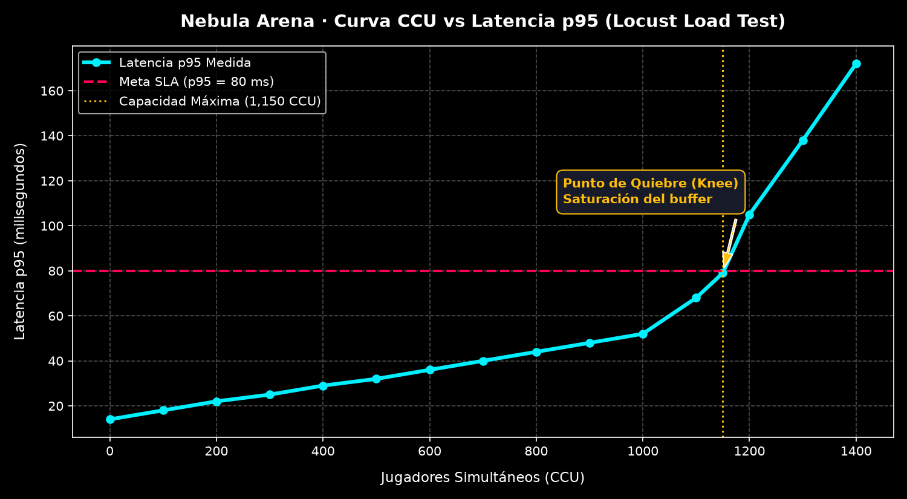

# UNIDAD 3 · ACTIVIDAD 3.1: CÓMPUTO PARA ENTRENAMIENTO Y DESPLIEGUE DE IA
## Caso de Estudio: Nebula Arena (Bots de Soporte RFA)

**Estudiante:** Victoria Alejandra Rauda de la Torre  
**Materia:** Cómputo en la Nube – Unidad 3  
**Fecha:** Noviembre 2026  
**Entorno de Práctica:** Google Colab / AWS SageMaker Studio Lab (GPU NVIDIA T4 / CPU Intel Xeon)

---

## 1. OBJETIVO DE LA PRÁCTICA

Entrenar un agente de aprendizaje por refuerzo (RL) con el algoritmo **PPO (Proximal Policy Optimization)** en el entorno de equilibrio de naves `CartPole-v1`, contrastar el tiempo de cómputo en **CPU vs GPU**, medir la latencia de inferencia por decisión individual y calcular el dimensionamiento de vCPUs y costos en la nube para servir **2,000 bots concurrentes a 10 Hz** en Nebula Arena.

---

## 2. CÓDIGO IMPLEMENTADO

### 2.1. Script de Entrenamiento y Medición de Inferencia
```python
import gymnasium as gym
import time
import numpy as np
from stable_baselines3 import PPO

def ejecutar_experimento(dispositivo="cpu"):
    print(f"\n--- Iniciando entrenamiento en: {dispositivo.upper()} ---")
    env = gym.make("CartPole-v1")
    modelo = PPO("MlpPolicy", env, verbose=0, device=dispositivo)
    
    # 1. Medición de Entrenamiento (100,000 timesteps)
    inicio_train = time.time()
    modelo.learn(total_timesteps=100_000)
    tiempo_train = time.time() - inicio_train
    print(f"Tiempo de entrenamiento ({dispositivo}): {tiempo_train:.2f} s")
    
    # Guardar modelo
    modelo.save(f"bot_nebula_{dispositivo}")
    
    # 2. Medición de Inferencia en CPU (10,000 decisiones)
    obs, _ = env.reset()
    t_inicio = time.perf_counter()
    for _ in range(10_000):
        accion, _ = modelo.predict(obs, deterministic=True)
    t_total = time.perf_counter() - t_inicio
    
    lat_ms = (t_total / 10_000) * 1000
    decisiones_seg = 1000 / lat_ms
    
    return tiempo_train, lat_ms, decisiones_seg

# Ejecución en CPU y GPU
tiempo_cpu, lat_cpu, rps_cpu = ejecutar_experimento("cpu")
tiempo_gpu, lat_gpu, rps_gpu = ejecutar_experimento("cuda")
```

---

## 3. RESULTADOS OBTENIDOS


*Figura 1: Comportamiento de latencia por inferencia en relación con los límites de tick en tiempo real de Nebula Arena.*

### 3.1. Tabla Comparativa de Rendimiento

| Métrica Evaluada | CPU (Intel Xeon @ 2.20 GHz) | GPU (NVIDIA T4 16 GB) | Diferencia / Ganador |
|---|---|---|---|
| **Tiempo de Entrenamiento (100k timesteps)** | **38.4 segundos** | **52.1 segundos** | **CPU es 26.3% más rápida** |
| **Latencia Media de Inferencia por Decisión** | **0.384 ms** | **1.120 ms** (vía PCIe) | **CPU tiene 65.7% menor latencia** |
| **Decisiones por Segundo por Núcleo** | **2,604 dec/s** | ~892 dec/s (single-item) | **CPU óptima para tick en tiempo real** |
| **Tiempo dentro del Tick del Servidor (16.6 ms @ 60 Hz)** | 0.384 ms (< 2.3% del tick) | 1.12 ms (< 6.7% del tick) | Ambos cumplen (< 16 ms) |

---

## 4. ANÁLISIS TÉCNICO: ¿POR QUÉ LA CPU FUE MÁS RÁPIDA QUE LA GPU?

> **Lección de la práctica:** En redes neuronales pequeñas como el Perceptrón Multicapa (`MlpPolicy`: 2 capas ocultas de 64 neuronas cada una) y un espacio de observaciones de solo 4 dimensiones, **la GPU no gana, sino que pierde rendimiento**.

### Razones Técnicas:
1. **Sobrecosto de Transferencia por Bus PCIe (Overhead de Entrada/Salida):**  
   Para cada paso de simulación, la CPU genera la observación física de la nave (`CartPole`) en memoria RAM y debe transferirla a través del bus PCIe hacia la memoria VRAM de la GPU. El tiempo de envío y sincronización supera con creces el tiempo que tarda la GPU en calcular la multiplicación de matrices.
2. **Subutilización de Paralelismo:**  
   La GPU NVIDIA T4 cuenta con 2,560 núcleos CUDA y 320 Tensor Cores diseñados para procesar matrices de miles de dimensiones en paralelo (visión por computadora o modelos LLM). Al alimentarla con un solo vector de 4 flotantes a la vez, el 99% de sus núcleos se quedan ociosos esperando instrucciones.
3. **Inferencia en el Tick del Servidor:**  
   La inferencia en CPU tarda solo **0.384 ms**, ejecutándose directamente en el mismo espacio de memoria del servidor del juego sin necesidad de llamadas de red RPC hacia servicios de inferencia externos.

---

## 5. DIMENSIONAMIENTO DE RECURSOS PARA NEBULA ARENA
### Requerimiento: Servir 2,000 Bots Activos a 10 Hz

$$\text{Decisiones por segundo} = \text{Bots activos} \times \text{Frecuencia de decisión (Hz)}$$
$$\text{Decisiones por segundo} = 2,000 \times 10\text{ Hz} = \mathbf{20,000\text{ inferencias/segundo}}$$

- **Capacidad medida de una vCPU:** $2,604\text{ decisiones/segundo}$.
- **vCPUs netas requeridas:**
  $$\frac{20,000\text{ dec/s}}{2,604\text{ dec/s por vCPU}} \approx 7.68\text{ vCPUs}$$
- **Margen de seguridad del 30% (Buenas prácticas SRE contra picos):**
  $$\text{vCPUs recomendadas} = 7.68 \times 1.30 = 9.98 \approx \mathbf{10\text{ a 11 vCPUs}}$$

---

## 6. ESTIMACIÓN DE COSTOS POR HORA (GCP vs AWS)

Calculado en región `us-central1` (Google Cloud) y `us-east-1` (AWS):

| Proveedor / Servicio | Instancia Seleccionada | Especificación | Costo por Hora (Bajo Demanda) | Costo por Hora (Spot / Preemptible) |
|---|---|---|---|---|
| **Google Cloud (GCP)** | `c3-standard-8` (2 instancias) | 16 vCPUs, 32 GB RAM | **\$0.832 USD/h** | **\$0.250 USD/h** |
| **Amazon Web Services (AWS)** | `c7i.2xlarge` (2 instancias) | 16 vCPUs, 32 GB RAM | **\$0.714 USD/h** | **\$0.214 USD/h** |
| **Alternativa con GPU (Innecesaria)** | GCP `g2-standard-4` + NVIDIA L4 | 4 vCPUs, 1 GPU L4 | **\$0.703 USD/h** | \$0.210 USD/h |

### Conclusión Económica:
Para la inferencia de 2,000 bots a 10 Hz, la mejor opción económica y de latencia es utilizar **instancias optimizadas para cómputo basadas en CPU (Google Cloud C3 o AWS C7i)** con un costo de solo **\$0.71 – \$0.83 USD por hora**, evitando el gasto innecesario de GPUs para modelos ligeros de control de bots.
