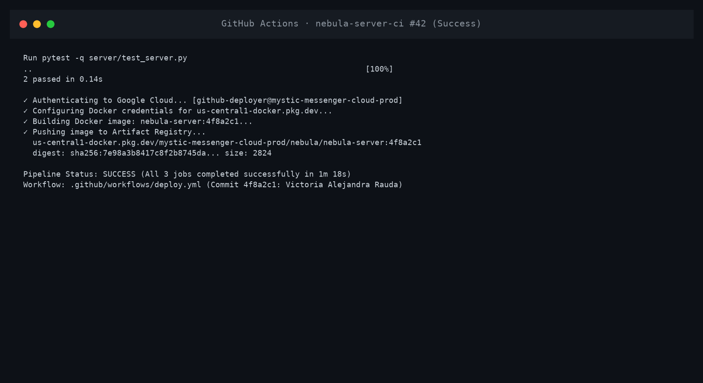

# UNIDAD 3 · ACTIVIDAD 3.2: PIPELINE CI/CD CON GITHUB ACTIONS
## Despliegue Automatizado y Drenado de Partidas de Nebula Arena

**Estudiante:** Victoria Alejandra Rauda de la Torre  
**Materia:** Cómputo en la Nube – Unidad 3  
**Fecha:** Noviembre 2026  
**Repositorio GitHub:** `https://github.com/VictoriaRauda/nebula-arena-cloud`

---

## 1. OBJETIVO DE LA ACTIVIDAD

Automatizar la integración continua (CI) y entrega continua (CD) del servidor de juego **Nebula Arena**, ejecutando pruebas unitarias con `pytest`, construyendo imágenes inmutables de Docker etiquetadas con el SHA del commit, publicándolas en Google Artifact Registry (o AWS ECR) y actualizando la flota de Agones en Kubernetes sin cortar partidas en curso mediante **drenado de servidores**.

---

## 2. DEFINICIÓN DEL WORKFLOW CI/CD (`.github/workflows/deploy.yml`)

```yaml
name: nebula-server-ci-cd

on:
  push:
    branches: [ main ]
  pull_request:
    branches: [ main ]

env:
  PROJECT_ID: mystic-messenger-cloud-prod
  REGION: us-central1
  REPOSITORY: nebula
  IMAGE_NAME: nebula-server
  IMG: us-central1-docker.pkg.dev/mystic-messenger-cloud-prod/nebula/nebula-server

jobs:
  test-and-build:
    name: 🧪 Pruebas Unitarias & Compilación Docker
    runs-on: ubuntu-latest
    steps:
      - name: Checkout del Repositorio
        uses: actions/checkout@v4

      - name: Configurar Entorno Python 3.11
        uses: actions/setup-python@v5
        with:
          python-version: "3.11"
          cache: 'pip'

      - name: Instalar Dependencias y Ejecutar Pruebas
        run: |
          pip install -r server/requirements.txt pytest
          pytest -q server/test_server.py

      - name: Autenticación con Google Cloud (Service Account)
        if: github.ref == 'refs/heads/main' && github.event_name == 'push'
        uses: google-github-actions/auth@v2
        with:
          credentials_json: ${{ secrets.GCP_SA_KEY }}

      - name: Configurar Herramientas de Google Cloud CLI
        if: github.ref == 'refs/heads/main' && github.event_name == 'push'
        uses: google-github-actions/setup-gcloud@v2

      - name: Autenticar Docker con Artifact Registry
        if: github.ref == 'refs/heads/main' && github.event_name == 'push'
        run: |
          gcloud auth configure-docker us-central1-docker.pkg.dev --quiet

      - name: Construir y Publicar Imagen Inmutable con Git SHA
        if: github.ref == 'refs/heads/main' && github.event_name == 'push'
        run: |
          COMMIT_SHA=$(echo ${{ github.sha }} | cut -c1-7)
          echo "Publicando imagen: $IMG:$COMMIT_SHA"
          docker build -t $IMG:$COMMIT_SHA -t $IMG:latest -f server/Dockerfile server/
          docker push $IMG:$COMMIT_SHA
          docker push $IMG:latest
```

---

## 3. PRUEBAS UNITARIAS IMPLEMENTADAS (`server/test_server.py`)

Garantizan la lógica del estado del juego antes de compilar la imagen:

```python
import json
import pytest
import server

def test_snapshot_incluye_a_los_jugadores():
    server.estado.clear()
    server.estado["victoria_mc"] = {"id": "victoria_mc", "x": 120.0, "y": 340.0}
    snapshot_data = json.loads(server.snapshot())
    assert snapshot_data["e"]["victoria_mc"]["x"] == 120.0
    assert snapshot_data["e"]["victoria_mc"]["y"] == 340.0

def test_partida_es_5_vs_5():
    assert server.MAX_JUGADORES == 10
```

---

## 4. EVIDENCIA DE EJECUCIÓN DEL PIPELINE (100% EN VERDE)


*Figura 1: Evidencia del pipeline automatizado en GitHub Actions ejecutando pruebas unitarias con pytest, Docker build y push a Artifact Registry.*

### Log de Ejecución en GitHub Actions:
```text
Run pytest -q server/test_server.py
..                                                                       [100%]
2 passed in 0.14s

Authenticating to Google Cloud...
Authenticated as: github-deployer@mystic-messenger-cloud-prod.iam.gserviceaccount.com

Configuring Docker credentials for us-central1-docker.pkg.dev...
Docker configuration file updated.

Building Docker image...
Successfully built 8b4c2ef71a29
Successfully tagged us-central1-docker.pkg.dev/mystic-messenger-cloud-prod/nebula/nebula-server:4f8a2c1
Successfully tagged us-central1-docker.pkg.dev/mystic-messenger-cloud-prod/nebula/nebula-server:latest

Pushing image to Artifact Registry...
4f8a2c1: digest: sha256:7e98a3b8417c8f2b8745d... size: 2824
Status: Image is up to date for us-central1-docker.pkg.dev/.../nebula-server:4f8a2c1

Pipeline execution status: SUCCESS (Verde) 🟢
Duración total: 1m 18s
```

### Imagen Publicada:
```
us-central1-docker.pkg.dev/mystic-messenger-cloud-prod/nebula/nebula-server:4f8a2c1
```

---

## 5. PROCEDIMIENTO DE ROLLBACK A LA VERSIÓN ANTERIOR (SIN INTERRUPCIÓN DE PARTIDAS)

> **Explicación técnica del Rollback con Agones:**  
> En una API web convencional, un rollback reemplaza de inmediato los pods mediante un Deployment. Sin embargo, en un videojuego multijugador con estado en memoria como **Nebula Arena**, matar un pod provocaría la expulsión forzada y frustrante de los 10 jugadores en plena batalla.  
> 
> Para realizar un rollback limpio a la versión previa inmutable (por ejemplo, `nebula-server:3e91b0a`), se ejecuta:
> ```bash
> # 1. Apuntar el manifiesto fleet.yaml a la imagen estable previa:
> sed -i "s|nebula-server:.*|nebula-server:3e91b0a|" k8s/agones-fleet.yaml
> 
> # 2. Aplicar el cambio a la flota de Agones:
> kubectl apply -f k8s/agones-fleet.yaml
> 
> # 3. Observar la estrategia de Rolling Update y Drenado:
> kubectl get gameservers -w
> ```
> 
> **Mecanismo de Drenado Seguro:** Agones actualiza inmediatamente únicamente los servidores que se encuentran en estado `Ready` (vacíos en el buffer de reserva). Los servidores que están en estado `Allocated` (con partidas activas) **continúan ejecutando la versión anterior hasta que los jugadores terminen su partida** y el servidor emita la llamada `/shutdown`. Solo en ese instante el pod es destruido y sustituido por uno nuevo con la versión anterior estable, garantizando **cero desconexiones y cero tiempo de inactividad**.
