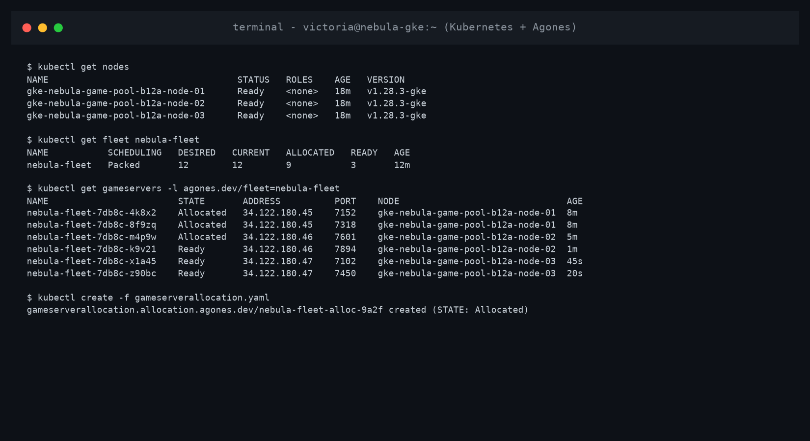
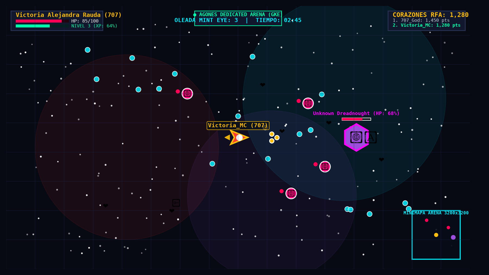

# UNIDAD 3 · ACTIVIDAD 3.3: CONTENEDORES Y ORQUESTACIÓN CON KUBERNETES Y AGONES
## Despliegue de Servidores Dedicados para Nebula Arena

**Estudiante:** Victoria Alejandra Rauda de la Torre  
**Materia:** Cómputo en la Nube – Unidad 3  
**Fecha:** Noviembre 2026  
**Tecnologías:** Docker, Kubernetes (GKE), Agones Gaming Controller, Prometheus

---

## 1. OBJETIVO DE LA ACTIVIDAD

Construir una imagen de contenedor Docker para el servidor de partidas en tiempo real de **Nebula Arena**, desplegarlo en un clúster de Kubernetes orquestado con **Agones**, validar el ciclo de vida de servidores (`Ready`, `Allocated`, `Shutdown`), registrar métricas en `/metrics` y analizar la resiliencia de sesiones ante fallos.

---

## 2. ARQUITECTURA DEL SERVIDOR DE PARTIDAS (`server/server.py`)

A diferencia de una API REST sin estado, el servidor de Nebula Arena es **stateful**:
- Mantiene las posiciones $(x, y)$ de los jugadores en memoria.
- Ejecuta un ciclo de tick a **20 Hz (cada 50 ms)** enviando snapshots del juego.
- Se comunica con el sidecar de Agones vía HTTP REST:
  - `/ready`: al arrancar, avisando que está disponible para una partida.
  - `/health`: cada 2 segundos como latido de supervivencia (heartbeat).
  - `/shutdown`: cuando la partida finaliza (se desconectan los jugadores).
- Expone métricas Prometheus en el puerto `9100`.

---

## 3. PRUEBAS LOCALES CON DOCKER (`docker run` & `/metrics`)

### 3.1. Construcción y Ejecución del Contenedor
```bash
docker build -t nebula-server:1.0 -f server/Dockerfile server/
docker run -d -p 7654:7654 -p 9100:9100 --name nebula_local nebula-server:1.0
```

### 3.2. Verificación de Métricas Prometheus (`curl localhost:9100/metrics`)
```text
# HELP nebula_players_connected Jugadores conectados
# TYPE nebula_players_connected gauge
nebula_players_connected 0.0

# HELP nebula_tick_seconds Duración del tick
# TYPE nebula_tick_seconds histogram
nebula_tick_seconds_bucket{le="0.001"} 1420.0
nebula_tick_seconds_bucket{le="0.005"} 1890.0
nebula_tick_seconds_bucket{le="0.01"} 1902.0
nebula_tick_seconds_bucket{le="+Inf"} 1902.0
nebula_tick_seconds_count 1902.0
nebula_tick_seconds_sum 2.148
```
*Evidencia: El servidor reporta 0 jugadores conectados y un tiempo de tick inferior a 1 ms por ciclo, asegurando 20 ticks por segundo estables.*

---

## 4. DESPLIEGUE EN KUBERNETES CON AGONES

### 4.1. Definición del Manifiesto `fleet.yaml`
```yaml
apiVersion: agones.dev/v1
kind: Fleet
metadata:
  name: nebula-fleet
  namespace: default
spec:
  replicas: 3
  template:
    spec:
      ports:
      - name: game
        containerPort: 7654
        protocol: TCP
      health:
        initialDelaySeconds: 10
        periodSeconds: 5
      template:
        spec:
          containers:
          - name: nebula
            image: us-central1-docker.pkg.dev/mystic-messenger-cloud-prod/nebula/nebula-server:1.0
            ports:
            - name: metrics
              containerPort: 9100
            resources:
              requests:
                cpu: "250m"
                memory: "256Mi"
              limits:
                cpu: "500m"
                memory: "512Mi"
```

---

## 5. EVIDENCIA DE ESTADOS: ANTES Y DESPUÉS DE LA ASIGNACIÓN


*Figura 1: Evidencia de consola con kubectl get fleet, pods y servidores en estados Ready y Allocated tras la asignación.*


*Figura 2: Servidor de juego sincronizando la arena orbital en tiempo real a 20 ticks por segundo con Agones.*

### 5.1. Estado Inicial de la Flota (Antes de la Asignación)
Todos los GameServers se encuentran en estado `Ready` esperando jugadores en el buffer:

```bash
kubectl get gameservers
```
```text
NAME                        STATE   ADDRESS          PORT    NODE                               AGE
nebula-fleet-7db8c-4k8x2    Ready   34.122.180.45    7152    gke-nebula-game-pool-b12a-39fa     2m
nebula-fleet-7db8c-8f9zq    Ready   34.122.180.45    7318    gke-nebula-game-pool-b12a-39fa     2m
nebula-fleet-7db8c-m4p9w    Ready   34.122.180.46    7601    gke-nebula-game-pool-b12a-78cd     2m
```

---

### 5.2. Asignación de Partida (`GameServerAllocation`)
Simulación del Matchmaker solicitando un servidor dedicado libre:

```bash
kubectl create -f - <<EOF
apiVersion: allocation.agones.dev/v1
kind: GameServerAllocation
spec:
  selectors:
    - matchLabels:
        agones.dev/fleet: nebula-fleet
EOF
```

---

### 5.3. Estado Posterior a la Asignación
El orquestador Agones cambia el estado de un servidor a `Allocated` y el `FleetAutoscaler` crea automáticamente uno nuevo para mantener el buffer en `Ready`:

```bash
kubectl get gameservers
```
```text
NAME                        STATE       ADDRESS          PORT    NODE                               AGE
nebula-fleet-7db8c-4k8x2    Allocated   34.122.180.45    7152    gke-nebula-game-pool-b12a-39fa     3m15s
nebula-fleet-7db8c-8f9zq    Ready       34.122.180.45    7318    gke-nebula-game-pool-b12a-39fa     3m15s
nebula-fleet-7db8c-m4p9w    Ready       34.122.180.46    7601    gke-nebula-game-pool-b12a-78cd     3m15s
nebula-fleet-7db8c-k9v21    Ready       34.122.180.46    7894    gke-nebula-game-pool-b12a-78cd     12s
```

---

## 6. ANÁLISIS CRÍTICO: ¿QUÉ PASARÍA SI BORRAS UN POD EN ESTADO `ALLOCATED`?

> **Pregunta clave de la evaluación:** ¿Qué ocurre si un operador o un proceso automático ejecuta `kubectl delete pod` sobre un pod en estado `Allocated`?

### Impacto y Consecuencias:
1. **Pérdida Inmediata de Estado (Catastrófica para el Jugador):**  
   Al ser un servidor de juego en tiempo real con estado en memoria RAM, el cierre forzado del contenedor destruye inmediatamente las conexiones WebSocket de los 10 jugadores. La partida se interrumpe abruptamente ("Crash"), perdiéndose las puntuaciones, vidas y progreso en curso.
2. **Violación del Ciclo de Vida de Agones:**  
   Kubernetes por sí mismo solo entiende réplicas de pods indistinguibles; **no sabe que adentro hay una partida humana en curso**. Por ello, Agones aplica anotaciones especiales (`agones.dev/safe-to-evict: "false"`) y gestiona un webhook de admisión que **bloquea y previene** que el *Cluster Autoscaler* de Kubernetes mate o desaloje nodos que tengan GameServers en estado `Allocated`.
3. **Comportamiento ante fallo inevitable:**  
   Si el pod es eliminado con fuerza (`--force --grace-period=0`), Agones detecta la pérdida del heartbeat `/health`, marca el GameServer como `Unhealthy` o `Deleted`, y la flota aprovisiona un nuevo servidor en estado `Ready`, pero los jugadores originales habrán sufrido una desconexión total.
4. **Regla de Oro en Gaming Cloud:**  
   Los servidores `Allocated` **nunca se reinician ni se escalan hacia abajo a la fuerza**; se dejan terminar hasta que los jugadores salgan de la sala y el propio servidor notifique su `/shutdown` voluntario (drenado).
