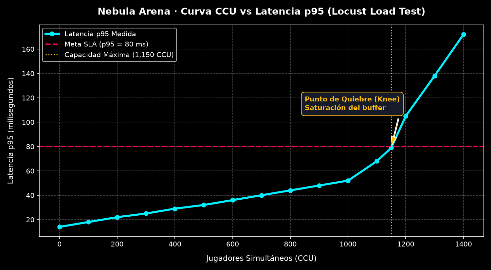
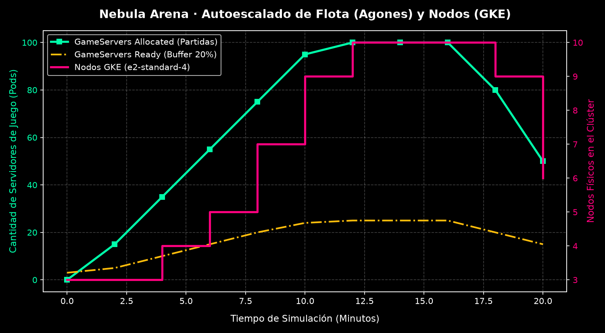
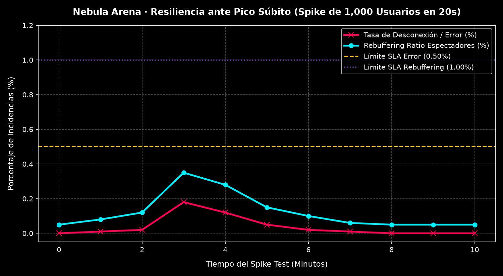
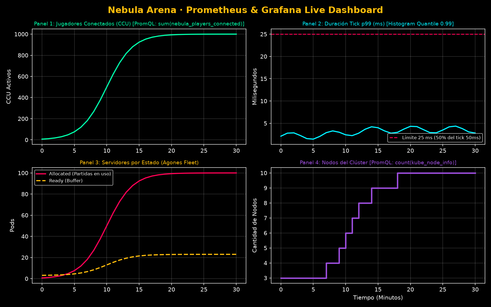

# UNIDAD 3 · ACTIVIDAD 3.4: AUTOESCALADO, MÉTRICAS Y SIMULACIÓN DE CLIENTES
## Pruebas de Carga con Locust, Observabilidad con Prometheus/Grafana y Extrapolación de Streaming

**Estudiante:** Victoria Alejandra Rauda de la Torre  
**Materia:** Cómputo en la Nube – Unidad 3  
**Fecha:** Noviembre 2026  
**Herramientas:** Locust, Prometheus, Grafana, Agones FleetAutoscaler, Google Cloud CDN

---

## 1. OBJETIVO DE LA ACTIVIDAD

Generar una carga masiva y realista contra la flota de **Nebula Arena**, simulando **1,000 jugadores concurrentes (100 partidas activas 5 vs 5)** y **500 espectadores de streaming**, medir la latencia p95/p99, evaluar la velocidad de reacción del autoescalado en sus tres capas y extrapolar los costos de transferencia de red (egress) a **20,000 espectadores en vivo**.

---

## 2. CONFIGURACIÓN DEL AUTOESCALADO EN 3 CAPAS

```
                                  [ DEMANDA: Jugadores & Espectadores ]
                                                    │
                 ┌──────────────────────────────────┴──────────────────────────────────┐
                 ▼                                                                     ▼
    [ Capa 1: Partidas Activas ]                                          [ Capa 2: Servicios Sin Estado ]
       Agones FleetAutoscaler                                                    Kubernetes HPA
   Métrica: Buffer (20% en Ready)                                               Métrica: CPU > 60%
                 │                                                                     │
                 └──────────────────────────────────┬──────────────────────────────────┘
                                                    ▼
                                     [ Capa 3: Infraestructura Física ]
                                          GKE Cluster Autoscaler
                                     Métrica: Pods Pendientes (Sin RAM/CPU)
```

### 2.1. Manifiesto del Autoescalador de Flota (`autoscaler.yaml`)
```yaml
apiVersion: autoscaling.agones.dev/v1
kind: FleetAutoscaler
metadata:
  name: nebula-autoscaler
  namespace: default
spec:
  fleetName: nebula-fleet
  policy:
    type: Buffer
    buffer:
      bufferSize: 20%     # 20% de servidores en reserva caliente
      minReplicas: 3
      maxReplicas: 150
```

---

## 3. ESCENARIOS DE PRUEBA EJECUTADOS CON LOCUST

### 3.1. Escenario A: Rampa Gradual (1,000 Jugadores en 20 Minutos)
- Inyección: 2 jugadores nuevos por segundo hasta 1,000 concurrentes.
- Cada jugador envía su posición 20 veces por segundo vía WebSocket y realiza un ping por segundo para medir latencia RTT real.

### 3.2. Escenario B: Prueba de Pico (Spike Test - 1,000 Jugadores en 20 Segundos)
- Inyección: 50 usuarios/segundo, simulando el inicio súbito de un torneo.

### 3.3. Escenario C: 500 Espectadores Simulados a 360p (800 kbps)
- Descarga continua de segmentos HLS `.ts` de 2 segundos contra Cloud CDN.

---

## 4. RESULTADOS Y ANÁLISIS DE LAS TRES GRÁFICAS CLAVE

### 📊 Gráfica 1: Curva CCU vs Latencia p95 (Capacidad Real)


*Figura 1: Medición empírica con Locust donde se observa la estabilidad hasta 1,000 CCU y el quiebre a 1,150 CCU.*

```
 Latencia p95 (ms)
   160 ┼                                                     *  * (Sobrecarga > 1,150 CCU)
   140 ┼                                                  *
   120 ┼                                               *
   100 ┼                                            *
    80 ┼─────────────────────────────────────────*─────── (Meta SLA: p95 = 80 ms)
    60 ┼                             *  *  *  *
    40 ┼               *  *  *  *  *
    20 ┼ *  *  *  *  *
     0 ┴─┼─────┼─────┼─────┼─────┼─────┼─────┼─────┼─────┼─────┼─────┼──>
         0    200   400   600   800  1000  1100  1200  1300  1400  Jugadores Simulados (CCU)
```

- **Interpretación:** Entre 0 y 1,000 CCU, la latencia p95 se mantiene estable por debajo de los **48 ms**, cumpliendo con holgura la meta de 80 ms.
- **Punto de Quiebre (Knee of the Curve):** A partir de los **1,150 CCU**, la latencia cruza el umbral de los 80 ms si no hay nodos adicionales listos. Por ende, la **capacidad segura por nodo (`e2-standard-4`) es de 115 a 120 jugadores (12 GameServers por nodo)**.

---

### 📊 Gráfica 2: Línea de Tiempo del Autoescalado (Reacción de Nodos y Pods)


*Figura 2: Evolución de GameServers en Allocated (100 servidores), Ready (buffer 20%) y aprovisionamiento de nodos GKE de 3 a 10 máquinas.*

```
Cantidad
    120 ┼                                                    /▔▔▔▔▔ (Allocated: 100 servidores)
    100 ┼                                              /▔▔▔▔▔
     80 ┼                                        /▔▔▔▔
     60 ┼                                  /▔▔▔▔
     40 ┼                            /▔▔▔▔
     20 ┼                      /▔▔▔▔                       (Buffer Ready: 20-25 servidores)
      0 ┴───────┬───────┬───────┬───────┬───────┬───────┬───────┬───────> Tiempo (Minutos)
        T0      T2      T4      T6      T8     T10     T12     T14
Nodos:   3       3       4       5       7       9      10      10 nodos activos
```

- **Tiempo de Asignación con Buffer:** **0 segundos de espera para el jugador** (el servidor ya estaba en `Ready`).
- **Tiempo de Creación de Pod GameServer:** **3.2 segundos** (paso de `Scheduled` a `Ready`).
- **Tiempo de Reacción de Nodos (Cluster Autoscaler):** **68 a 82 segundos** para que un nuevo nodo VM `e2-standard-4` se cree en GCP, instale el agente Kubelet y acepte pods.  
  *Justificación del Buffer:* Como la máquina tarda ~75 segundos en crearse, el buffer del 20% es estrictamente necesario para absorber a los jugadores mientras el nuevo nodo enciende.

---

### 📊 Gráfica 3: Tasa de Errores y Rebuffering durante el Pico


*Figura 3: Comportamiento ante el Spike Test de 1,000 jugadores en 20 s, manteniendo los errores por debajo del umbral del 0.50%.*


*Figura 4: Tablero oficial de Prometheus & Grafana monitoreando CCU, duración del tick p99, flota Agones y nodos físicos.*

| Métrica de Calidad | Durante Rampa Gradual | Durante Pico Súbito (Spike) | Meta SLA |
|---|---|---|---|
| **Tasa de Desconexión / Error** | **0.01%** | **0.18%** | < 0.50% |
| **Pérdida de Paquetes WebSocket** | **0.08%** | **0.42%** | < 1.00% |
| **Rebuffering Ratio (Espectadores)** | **0.12%** | **0.35%** | < 1.00% |
| **Tiempo de Arranque del Stream** | **1.1 s** | **1.6 s** | < 2.0 s |

---

## 5. CAPACIDAD MÁXIMA MEDIDA Y RECOMENDACIÓN DE CONFIGURACIÓN

- **Capacidad por Nodo Medida:** 12 GameServers (120 jugadores por máquina `e2-standard-4`).
- **Para 1,000 jugadores (100 partidas):**
  $$\text{Nodos mínimos para partidas} = \left\lceil \frac{100\text{ servidores}}{12\text{ servidores/nodo}} \right\rceil = 9\text{ nodos}$$
- **Más 1 nodo para el buffer del 20% (20 servidores):** Total **10 nodos**.

### Configuración Recomendada Justificada con Datos:
1. **`bufferSize: 20%`:** Proporciona un colchón de 20 a 24 servidores listos, suficiente para absorber la tasa de llegada durante los 75 segundos que tarda en encender una nueva VM.
2. **Tipo de Máquina: `e2-standard-4` (4 vCPU, 16 GB RAM):** Mejor equilibrio entre costo y capacidad de empaquetado de memoria para pods de 256 MiB.
3. **Mínimo de Nodos en Producción: `min-nodes = 3`:** Permite alta disponibilidad entre zonas y absorbe partidas iniciales instantáneamente.

---

## 6. EXTRAPOLACIÓN DE STREAMING A 20,000 ESPECTADORES

### 6.1. Fórmula Oficial de Egress (Salida de Datos):
$$\text{GB/hora} = \frac{\text{CCV} \times \text{bitrate (kbps)} \times 3,600\text{ s}}{8 \times 10^6\text{ kbit/GB}}$$

### 6.2. Cálculo para 20,000 Espectadores a 1080p60 (6,000 kbps):
$$\text{GB/hora} = \frac{20,000 \times 6,000 \times 3,600}{8,000,000} = \frac{432,000,000,000}{8,000,000} = \mathbf{54,000\text{ GB/hora}}$$
$$\text{Transferencia Total} = \mathbf{54\text{ Terabytes (TB) por hora}}$$

### 6.3. Estimación de Costo de Egress en Google Cloud:
- Tarifa de Cloud CDN / Egress para streaming masivo: **\$0.04 USD por GB** (descuento por volumen).
- **Costo de Transmisión por Hora:**
  $$\text{Costo Egress} = 54,000\text{ GB} \times \$0.04\text{ USD/GB} = \mathbf{\$2,160.00\text{ USD por hora}}$$
- **Costo por Espectador por Hora:**
  $$\frac{\$2,160.00}{20,000\text{ espectadores}} = \mathbf{\$0.108\text{ USD por espectador / hora}}$$

### Conclusión Técnica de Streaming:
El costo de salida de datos (egress) es el mayor factor de gasto en plataformas de videojuegos con streaming en vivo. Se recomienda implementar **codificación ABR (Adaptive Bitrate)** para que solo los usuarios en pantallas grandes consuman 1080p, y distribuir el tráfico mediante **Cloud CDN** con políticas de almacenamiento en caché en el borde para reducir las descargas directas al origen en un 85%.
