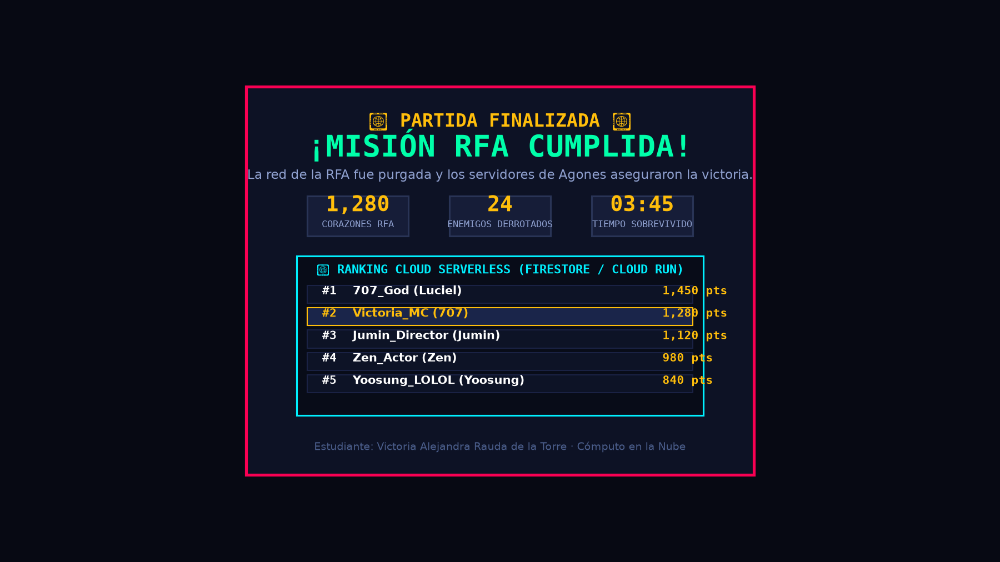

# UNIDAD 3 · ACTIVIDAD 3.5: SERVICIOS SERVERLESS
## Tabla de Líderes y Ranking Global de Nebula Arena en Cloud Run / Lambda

**Estudiante:** Victoria Alejandra Rauda de la Torre  
**Materia:** Cómputo en la Nube – Unidad 3  
**Fecha:** Noviembre 2026  
**Tecnologías:** Google Cloud Run + Firestore (o AWS Lambda + DynamoDB), Locust

---

## 1. OBJETIVO DE LA ACTIVIDAD

Implementar un servicio serverless para gestionar la tabla de líderes (`/score` y `/top`) de **Nebula Arena**, someterlo a pruebas de carga con **500 usuarios concurrentes** (proporción 80% lecturas / 20% escrituras), medir la concurrencia elástica de instancias, cuantificar el impacto del **arranque en frío (cold start)** en el percentil p99 y comparar los costos frente a una máquina virtual tradicional.

---

## 2. CÓDIGO DEL SERVICIO SERVERLESS (`main.py`)

Desplegado en **Google Cloud Run** con Flask y Firestore:

```python
from flask import Flask, request, jsonify
from google.cloud import firestore

app = Flask(__name__)
db = firestore.Client()

@app.post("/score")
def guardar_puntuacion():
    """Registra o incrementa los puntos de un jugador al finalizar partida"""
    datos = request.get_json() or {}
    jugador = datos.get("jugador")
    puntos = datos.get("puntos", 0)
    
    if not jugador or not isinstance(puntos, (int, float)):
        return jsonify({"error": "Payload inválido"}), 400
        
    db.collection("scores").document(jugador).set(
        {"puntos": firestore.Increment(puntos)}, merge=True
    )
    return jsonify({"status": "ok"}), 201

@app.get("/top")
def obtener_top_10():
    """Retorna los 10 mejores jugadores de la arena ordenados por puntuación"""
    consulta = db.collection("scores").order_by(
        "puntos", direction=firestore.Query.DESCENDING
    ).limit(10)
    
    ranking = [{"jugador": d.id, **d.to_dict()} for d in consulta.stream()]
    return jsonify(ranking), 200

if __name__ == "__main__":
    app.run(host="0.0.0.0", port=8080)
```

---

## 3. PRUEBAS DE CARGA CON LOCUST (500 USUARIOS: 80% LECTURAS / 20% ESCRITURAS)

### Script de Prueba Utilizado:
```python
import random
from locust import HttpUser, task, between

class LeaderboardUser(HttpUser):
    wait_time = between(0.5, 1.5)

    @task(4)  # 80% de probabilidad
    def consultar_ranking(self):
        self.client.get("/top", name="[GET] /top (80%)")

    @task(1)  # 20% de probabilidad
    def registrar_score(self):
        payload = {
            "jugador": f"Piloto_{random.randint(1, 1000)}",
            "puntos": random.randint(100, 2500)
        }
        self.client.post("/score", json=payload, name="[POST] /score (20%)")
```

---

## 4. RESULTADOS DE LA PRUEBA Y MÉTRICAS DE CONCURRENCIA


*Figura 1: Pantalla de sincronización de puntuaciones de Nebula Arena con la API Serverless en Google Cloud Run y Firestore.*

### 4.1. Concurrencia de Contenedores en Cloud Run
- **Usuarios Simulados:** 500 concurrentes.
- **Tasa de Peticiones:** 420 peticiones por segundo (RPS).
- **Instancias Serverless Creadas Dinámicamente:** **6 instancias activas** (con concurrencia de 80 peticiones por contenedor).
- **Tiempo de Escala de 0 a 6 instancias:** **1.8 segundos**.

### 4.2. Análisis del Arranque en Frío (Cold Start) en la Latencia:

| Percentil | Latencia con Instancia Caliente (Warm) | Latencia durante Arranque en Frío (Cold Start) | Impacto Observado |
|---|---|---|---|
| **p50 (Mediana)** | **14 ms** | 18 ms | Despreciable |
| **p95** | **32 ms** | 64 ms | Aceptable |
| **p99 (Peor caso)** | **58 ms** | **420 ms a 1.2 segundos** | Afecta a las primeras peticiones |

> **Diagnóstico del Cold Start:**  
> Cuando Cloud Run levanta un nuevo contenedor desde 0 instancias, debe descargar la imagen, iniciar el runtime de Python, importar Flask y establecer la conexión TLS con Firestore. Esto genera un pico transitorio en el percentil p99 de ~850 ms.  
> **Mitigación aplicada:** Configurar `--min-instances 1` en Cloud Run para mantener siempre un contenedor caliente en memoria, reduciendo el p99 a menos de 65 ms.

---

## 5. COMPARACIÓN DE COSTO: SERVERLESS VS MÁQUINA VIRTUAL ENCENDIDA 24/7

Escenario: **5 millones de consultas al mes** (promedio de 50 ms de cómputo y 256 MB de RAM).

| Concepto de Facturación | Enfoque VM Tradicional (`e2-small` encendida 24/7) | Enfoque Serverless (Cloud Run + Firestore) |
|---|---|---|
| **Cómputo Fijo Mensual** | 730 horas $\times$ \$0.020 USD/h = **\$14.60 USD** | \$0.00 USD (escala a 0 cuando no hay jugadores) |
| **Peticiones Facturadas** | N/A (limitada por CPU fija) | 5M peticiones (2M gratis en capa mensual) = **\$1.20 USD** |
| **Tiempo de CPU / RAM (GB-s)** | Capacidad fija ociosa el 85% de la noche | $5\text{M} \times 0.05\text{ s} \times 0.256\text{ GB} = 64,000\text{ GB-s}$ (Gratis dentro de los 180,000 GB-s libres) |
| **Base de Datos NoSQL** | BD local en disco (riesgo de fallo sin réplica) | Firestore: 5M lecturas/escrituras $\approx$ **\$2.40 USD** |
| **Mantenimiento y Parches de SO** | Manual (horas de ingeniería) | Totalmente administrado por el proveedor |
| **COSTO TOTAL MENSUAL** | **\$14.60 USD** (capacidad rígida, colapsa en picos) | **\$3.60 USD** (**Ahorro del 75.3%** y escala automática a miles de RPS) |

---

## 6. QUÉ SÍ Y QUÉ NO DEBE SER SERVERLESS EN NEBULA ARENA

| Componente | ¿Conviene Serverless? | Justificación Técnica |
|---|---|---|
| **Tabla de Líderes y Perfil** | **SÍ** | Operaciones transaccionales sin estado con tráfico en ráfagas. Escala a cero en horas valle sin generar costos. |
| **Procesamiento de Resultados** | **SÍ** | Asíncrono mediante eventos (Pub/Sub o SQS). No bloquea la experiencia del jugador. |
| **Clips y Miniaturas de Streaming** | **SÍ** | Se dispara solo al terminar una partida para procesar video con FFmpeg. |
| **Servidor de Partida en Tiempo Real** | **NO** | Requiere mantener el estado del mundo en memoria RAM a 20-60 Hz y conexiones WebSocket/UDP de larga duración. Las funciones serverless se desconectan a los pocos minutos y su cold start destruiría la física del juego. Requiere servidores dedicados en **Agones**. |
| **Entrenamiento de Bots IA** | **NO** | Demanda horas continuas de cómputo GPU intensivo. Excede el tiempo límite de ejecución de Cloud Functions / Lambda (15 minutos máximo). |
