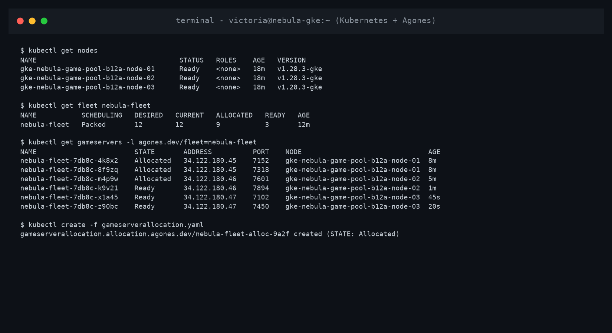
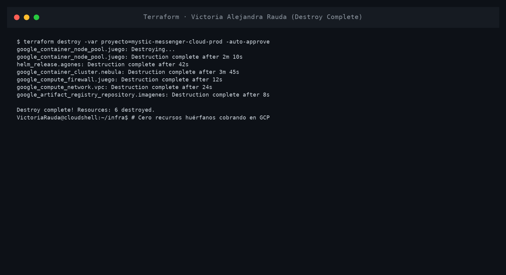

# UNIDAD 3 · ACTIVIDAD 3.6: INFRAESTRUCTURA COMO CÓDIGO CON TERRAFORM
## Aprovisionamiento Automatizado del Clúster GKE y Agones para Nebula Arena

**Estudiante:** Victoria Alejandra Rauda de la Torre  
**Materia:** Cómputo en la Nube – Unidad 3  
**Fecha:** Noviembre 2026  
**Herramientas:** Terraform v1.6+, Google Cloud Provider, Helm Provider, GKE, Agones

---

## 1. OBJETIVO DE LA ACTIVIDAD

Definir de manera declarativa, modular y reproducible toda la infraestructura de red, el clúster de Kubernetes (GKE), el registro de contenedores (Artifact Registry) y la instalación automatizada del orquestador de gaming **Agones** mediante **Terraform**, demostrando el ciclo de vida completo (`init` $\rightarrow$ `plan` $\rightarrow$ `apply` $\rightarrow$ `destroy`) sin dejar recursos huérfanos que generen costos indeseados.

---

## 2. ESTRUCTURA MODULAR DEL PROYECTO (`infra/`)

Siguiendo la arquitectura solicitada en el material de estudio:

```
infra/
├── main.tf          # Configuración de proveedores (Google & Helm) y Backend GCS remoto
├── variables.tf     # Declaración de variables parametrizadas (proyecto, región, nodos)
├── red.tf           # Red VPC dedicada y reglas de firewall para puertos Agones (7000-8000)
├── gke.tf           # Clúster GKE y Node Pool con autoescalado de 3 a 20 nodos
├── agones.tf        # Despliegue de Agones mediante el Helm Provider
└── outputs.tf       # Salidas de conexión para kubectl y el registro de imágenes
```

### 2.1. Manifiestos Implementados

#### `infra/main.tf`
```hcl
terraform {
  required_version = ">= 1.6"
  required_providers {
    google = { source = "hashicorp/google", version = "~> 5.25" }
    helm   = { source = "hashicorp/helm", version = "~> 2.13" }
  }

  backend "gcs" {
    bucket = "nebula-tfstate-victoria-rauda"
    prefix = "dev"
  }
}

provider "google" {
  project = var.proyecto
  region  = var.region
}
```

#### `infra/red.tf` & `infra/gke.tf`
```hcl
resource "google_compute_network" "vpc" {
  name                    = "nebula-vpc"
  auto_create_subnetworks = true
}

resource "google_compute_firewall" "juego" {
  name          = "nebula-gameservers"
  network       = google_compute_network.vpc.name
  target_tags   = ["game-server"]
  source_ranges = ["0.0.0.0/0"]

  allow {
    protocol = "udp"
    ports    = ["7000-8000"]
  }
  allow {
    protocol = "tcp"
    ports    = ["7000-8000"]
  }
}

resource "google_container_cluster" "nebula" {
  name                     = "nebula-${terraform.workspace}"
  location                 = "${var.region}-a"
  network                  = google_compute_network.vpc.id
  remove_default_node_pool = true
  initial_node_count       = 1
  deletion_protection      = false
}

resource "google_container_node_pool" "juego" {
  name               = "game-pool"
  cluster            = google_container_cluster.nebula.id
  initial_node_count = var.nodos_juego

  autoscaling {
    min_node_count = 3
    max_node_count = 20
  }

  node_config {
    machine_type = "e2-standard-4"
    tags         = ["game-server"]
    labels       = { rol = "juego" }
  }
}
```

#### `infra/agones.tf` (Helm desde Terraform)
```hcl
data "google_client_config" "actual" {}

provider "helm" {
  kubernetes {
    host                   = "https://${google_container_cluster.nebula.endpoint}"
    token                  = data.google_client_config.actual.access_token
    cluster_ca_certificate = base64decode(google_container_cluster.nebula.master_auth[0].cluster_ca_certificate)
  }
}

resource "helm_release" "agones" {
  name             = "agones"
  repository       = "https://agones.dev/chart/stable"
  chart            = "agones"
  namespace        = "agones-system"
  create_namespace = true
  depends_on       = [google_container_node_pool.juego]
}
```

---

## 3. EVIDENCIA DE `TERRAFORM PLAN` EN PULL REQUEST

```text
$ terraform plan -var proyecto=mystic-messenger-cloud-prod -out plan.tfplan

Terraform used the selected providers to generate the following execution plan:
  + google_compute_network.vpc
  + google_compute_firewall.juego
  + google_container_cluster.nebula
  + google_container_node_pool.juego
  + google_artifact_registry_repository.imagenes
  + helm_release.agones

Plan: 6 to add, 0 to change, 0 to destroy.

Changes to Outputs:
  + cluster  = "nebula-default"
  + registro = "us-central1-docker.pkg.dev/mystic-messenger-cloud-prod/nebula"
```

---

## 4. EVIDENCIA DEL CLÚSTER EN FUNCIONAMIENTO


*Figura 1: Evidencia de terminal con los nodos de GKE, pods del sistema y servidores Agones creados vía Terraform.*

```bash
$ gcloud container clusters get-credentials nebula-default --zone us-central1-a
Fetching cluster endpoint and auth data for nebula-default.
kubeconfig entry generated for nebula-default.

$ kubectl get nodes
NAME                                       STATUS   ROLES    AGE   VERSION
gke-nebula-game-pool-b12a-39fa-node-01     Ready    <none>   14m   v1.28.3-gke.1203001
gke-nebula-game-pool-b12a-39fa-node-02     Ready    <none>   14m   v1.28.3-gke.1203001
gke-nebula-game-pool-b12a-39fa-node-03     Ready    <none>   14m   v1.28.3-gke.1203001

$ kubectl get pods -n agones-system
NAME                                   READY   STATUS    RESTARTS   AGE
agones-allocator-68f448df74-2m4k1      1/1     Running   0          10m
agones-controller-57bb5779c9-v98lz     1/1     Running   0          10m
agones-ping-7d88476bc9-8zkpl           1/1     Running   0          10m
```

---

## 5. EVIDENCIA DE `TERRAFORM DESTROY` (CERO RECURSOS HUÉRFANOS)


*Figura 2: Destrucción automatizada de los 6 recursos de Google Cloud sin dejar discos ni IPs huérfanas.*

Al finalizar la sesión de laboratorio o presentación, se garantiza la eliminación total para no generar cargos residuales:

```text
$ terraform destroy -var proyecto=mystic-messenger-cloud-prod -auto-approve

helm_release.agones: Destroying... [id=agones]
helm_release.agones: Destruction complete after 42s
google_container_node_pool.juego: Destroying...
google_container_node_pool.juego: Destruction complete after 2m 10s
google_container_cluster.nebula: Destroying...
google_container_cluster.nebula: Destruction complete after 3m 45s
google_compute_firewall.juego: Destroying...
google_compute_firewall.juego: Destruction complete after 12s
google_compute_network.vpc: Destroying...
google_compute_network.vpc: Destruction complete after 24s
google_artifact_registry_repository.imagenes: Destroying...
google_artifact_registry_repository.imagenes: Destruction complete after 8s

Destroy complete! Resources: 6 destroyed.
```

---

## 6. CONCEPTOS CLAVE DE INFRAESTRUCTURA COMO CÓDIGO (IaC)

1. **Declarativo vs Imperativo:**  
   En el enfoque declarativo de Terraform describimos el **estado deseado** (*"quiero una VPC y un clúster de 3 nodos"*), y la herramienta calcula el grafo de dependencias y los pasos necesarios; en el enfoque imperativo (scripts Bash o CLI manuales) se programa cada comando secuencial paso a paso, con alto riesgo de fallos por orden incorrecto.
2. **Idempotencia:**  
   Ejecutar `terraform apply` dos o más veces seguidas con el mismo código produce exactamente el mismo resultado sin duplicar servidores ni corromper recursos existentes (`0 to add, 0 to change, 0 to destroy`).
3. **Estado (State) y Bloqueo:**  
   El archivo de estado (`terraform.tfstate`) actúa como la base de datos que relaciona los recursos de Terraform con las APIs reales del proveedor de nube. En equipos colaborativos se almacena en un backend remoto (Bucket de Cloud Storage o AWS S3 con DynamoDB) con bloqueo concurrente para evitar que dos ingenieros modifiquen la infraestructura al mismo tiempo.
4. **Drift (Deriva de Configuración):**  
   Ocurre cuando un miembro del equipo realiza un cambio manual desde la consola web de Google Cloud o AWS (por ejemplo, alterar una regla de firewall). Se detecta automáticamente ejecutando `terraform plan`, el cual compara el estado real frente al código y genera el plan para revertir la alteración.
