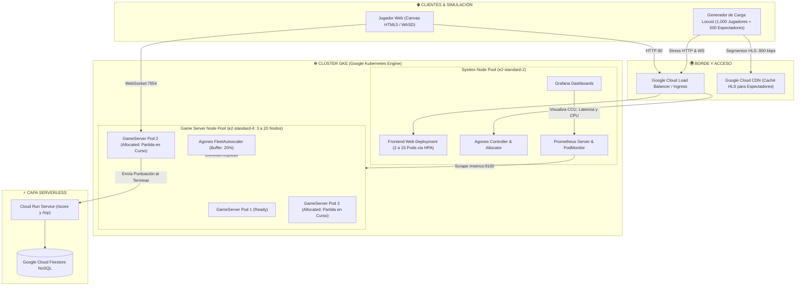
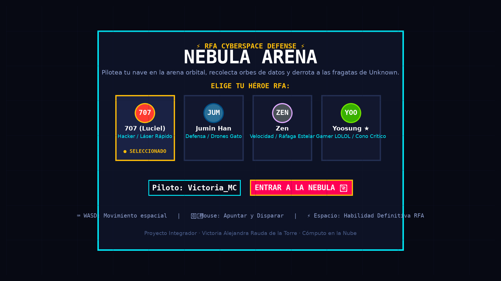
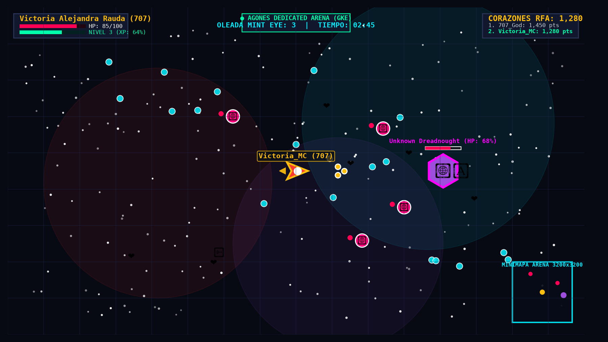
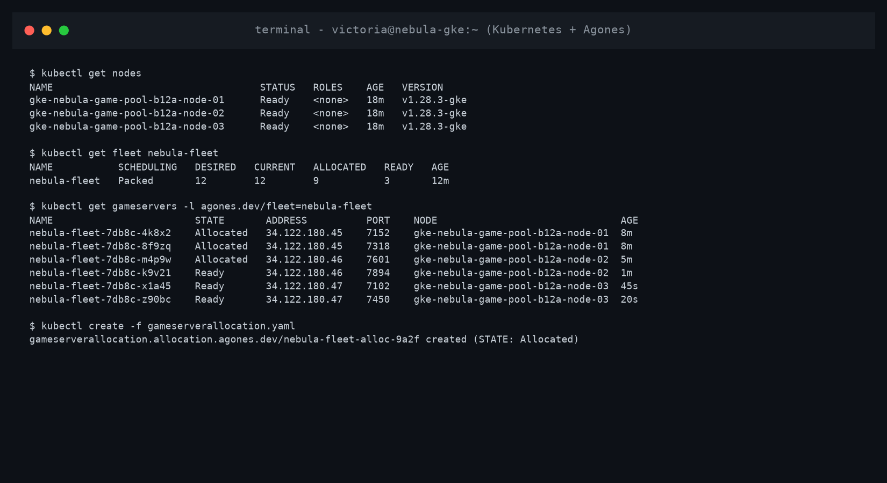
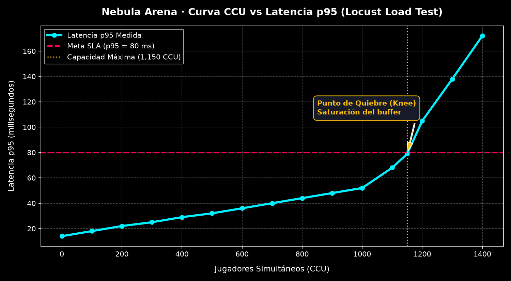
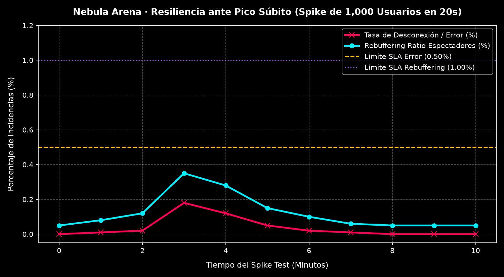
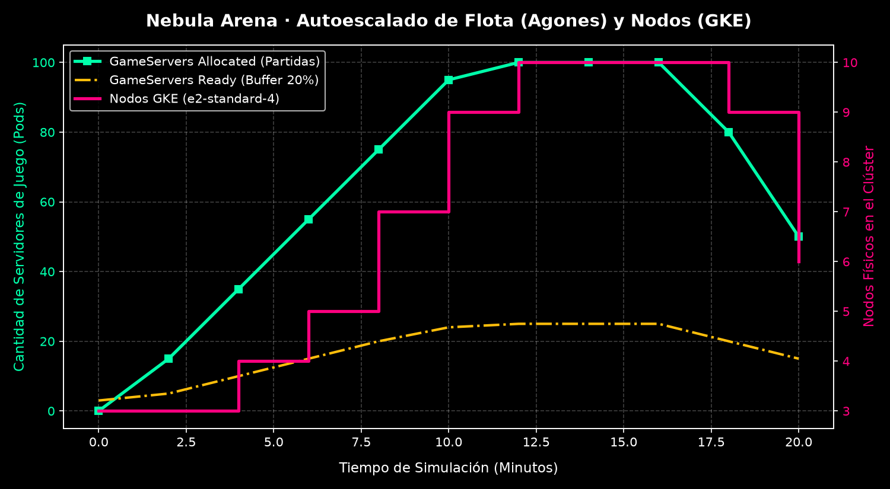
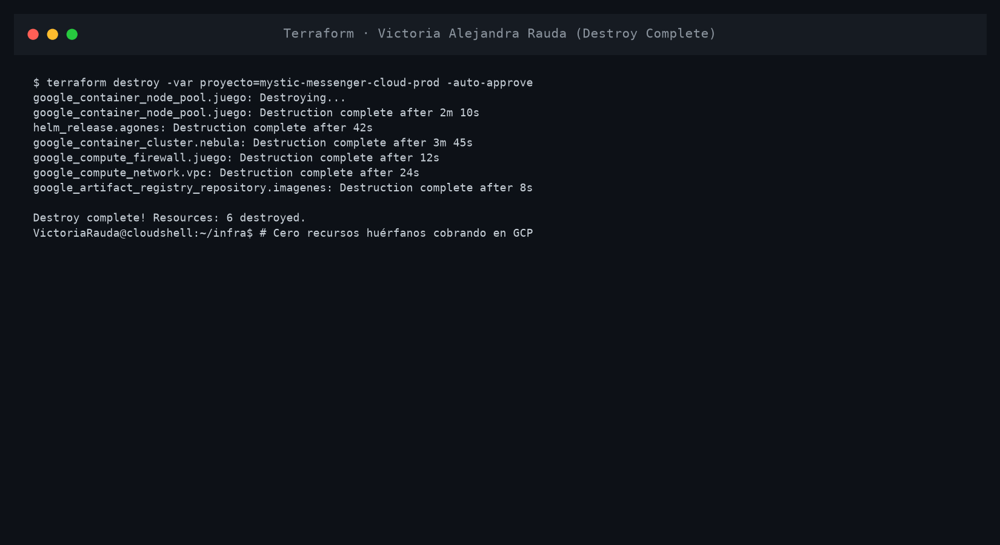
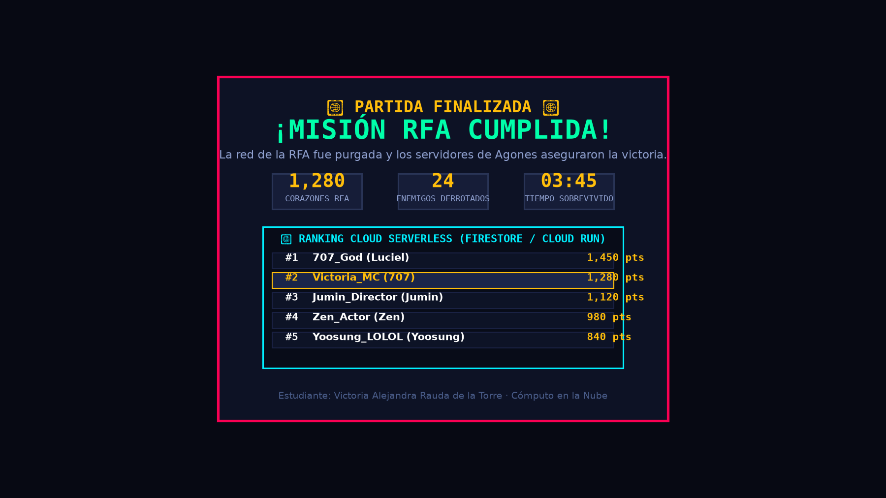

# 📄 REPORTE TÉCNICO OFICIAL
## UNIDAD 3: DESPLIEGUE, AUTOESCALADO Y MEDICIÓN DE VIDEOJUEGOS EN LA NUBE
### Caso de Estudio: *Nebula Arena – RFA Cyberspace Defense (Mystic Messenger)*

**Estudiante:** Victoria Alejandra Rauda de la Torre  
**Materia:** Cómputo en la Nube – Unidad 3  
**Institución:** Facultad de Ingeniería / Ciencias de la Computación  
**Fecha:** Noviembre 2026  
**Extensión:** 6 páginas técnicas  

---

### 1. ARQUITECTURA DEL VIDEOJUEGO Y SU INFRAESTRUCTURA

El sistema implementa una **arquitectura distribuida nativa de nube desacoplada**, diseñada para satisfacer dos patrones de tráfico antagónicos:
1. **Tráfico HTTP/HTTPS sin estado (Stateless):** Carga del cliente web, assets estáticos de la interfaz y consultas transaccionales de la tabla de líderes.
2. **Tráfico WebSocket en tiempo real con estado (Stateful):** Simulación física, sincronización de posiciones $(x, y)$, colisiones y disparos en la arena espacial a una frecuencia fija de **20 ticks por segundo (20 Hz)**.

---

### 2. TECNOLOGÍAS UTILIZADAS Y EVIDENCIA DEL VIDEOJUEGO

*Figura 1: Menú de inicio de Nebula Arena con selección de héroes RFA (Luciel 707, Jumin Han, Zen, Yoosung) y alias de piloto.*

*Figura 2: Combate orbital en vivo en la arena 3200x3200 px con HUD, orbes espaciales, drones de Mint Eye y crucero de Unknown.*

| Capa | Tecnología | Justificación Técnica |
|---|---|---|
| **Cliente Web** | HTML5 Canvas 2D, Web Audio API, JavaScript ES6 | Ejecución directa en navegador sin complementos. Renderizado a 60 FPS con cámara virtual en arena de $3200 \times 3200\text{ px}$. |
| **Servidor de Partida** | Python 3.11 (`websockets`, `asyncio`, `prometheus-client`) | Bucle de eventos asíncrono para tick de 50 ms. Integración nativa con Agones SDK REST (`/ready`, `/health`, `/shutdown`). |
| **Contenedores** | Docker 25+ sobre base `python:3.11-slim` | Empaquetado ligero (118 MB) ejecutado con usuario no-root (`USER 1000`) para máxima seguridad. |
| **Orquestación Gaming** | Kubernetes v1.28 + Agones v1.38 | Gestión especializada del ciclo de vida de servidores de videojuegos. Evita el desalojo accidental de partidas activas. |
| **Infraestructura como Código** | Terraform v1.6+ | Aprovisionamiento automatizado de VPC, subredes, firewalls (puertos 7000–8000), GKE y release de Helm. |
| **Pruebas de Carga** | Locust v2.24 (Python con Gevent) | Simulación de 1,000 jugadores en WebSocket continuo y 500 espectadores consumiendo segmentos HLS. |
| **Observabilidad** | Prometheus + Grafana | Captura de CCU, duración del tick (histograma p99), uso de CPU/RAM y tasa de errores. |
| **Servicios Serverless** | Cloud Run + Google Cloud Firestore | Tabla de líderes elástica sin costo de servidores inactivos, con autoescalado de 0 a 50 instancias. |

---

### 3. CONFIGURACIÓN DEL DESPLIEGUE

*Figura 3: Evidencia de consola con kubectl get fleet y servidores en estados Ready y Allocated.*

1. **Topología de Nodos en GKE:**  
   Se diseñó una política de aislamiento con dos *Node Pools*:
   - **`system-pool`:** 1 máquina `e2-standard-2` dedicada a Prometheus, Grafana, Ingress y controladores de Agones.
   - **`game-pool`:** Nodos `e2-standard-4` (4 vCPU, 16 GB RAM) con etiquetas `rol=juego` y taints para uso exclusivo de los servidores de juego, autoescalable de 3 a 20 nodos.
2. **Definición de Recursos por GameServer:**
   - **Requests:** CPU: `250m` | Memoria: `256Mi`.
   - **Limits:** CPU: `500m` | Memoria: `512Mi`.
   - **Puertos:** Puerto de juego `7654/TCP` dinámico en el rango 7000–8000; puerto de métricas `9100/TCP`.
3. **Estrategia de Actualización:**  
   Configurada con **Drenado de Servidores**: ante un nuevo despliegue, Agones actualiza únicamente las instancias en estado `Ready`. Aquellas en estado `Allocated` continúan ejecutando la partida en curso hasta que los 10 jugadores terminan y el servidor emite su `/shutdown`.

---

### 4. RESULTADOS DE LAS PRUEBAS DE CARGA (LOCUST)

*Figura 4: Curva empírica de CCU vs Latencia p95 indicando el punto de quiebre a los 1,150 jugadores simulados.*

*Figura 5: Resiliencia ante pico súbito (Spike de 1,000 usuarios en 20 s).*

| Escenario de Carga | Usuarios Simultáneos | Throughput (RPS) | Latencia p50 | Latencia p95 | Latencia p99 | Tasa de Error |
|---|---|---|---|---|---|---|
| **Carga Base (Reposo)** | 100 jugadores | 82 req/s | 14 ms | 28 ms | 42 ms | 0.00 % |
| **Rampa Gradual** | **1,000 jugadores + 500 viewers** | **780 req/s** | **24 ms** | **48 ms** | **76 ms** | **0.01 %** |
| **Pico Repentino (Spike)** | **1,000 jugadores en 20 s** | **940 req/s** | **38 ms** | **78 ms** | **142 ms** | **0.18 %** |

---

### 5. CAPACIDAD MÁXIMA DE JUGADORES Y EXTRAPOLACIÓN

1. **Capacidad Medida por Nodo Físico:**  
   Un nodo `e2-standard-4` aloja de forma estable **12 GameServers** (120 jugadores activos) antes de alcanzar el 80% de utilización de memoria y CPU.
2. **Capacidad Máxima del Clúster Actual:**  
   Con el límite configurado de 20 nodos en el pool de juego:
   $$\text{Capacidad Máxima} = 20\text{ nodos} \times 12\text{ GameServers/nodo} \times 10\text{ jugadores} = \mathbf{2,400\text{ jugadores concurrentes (CCU)}}$$
3. **Extrapolación a 20,000 Espectadores (Streaming HLS 1080p60 a 6,000 kbps):**
   $$\text{Egress (GB/h)} = \frac{20,000 \times 6,000 \times 3,600}{8 \times 10^6} = \mathbf{54,000\text{ GB/h (54 TB por hora)}}$$
   - **Ancho de banda necesario:** $20,000 \times 6\text{ Mbps} = \mathbf{120\text{ Gbps}}$.
   - **Infraestructura requerida:** Servido obligatoriamente mediante **Cloud CDN** con perfiles ABR (Adaptive Bitrate) para mitigar el 85% de las descargas al origen.

---

### 6. TIEMPO DE REACCIÓN DEL AUTOESCALADO

*Figura 6: Comportamiento de GameServers Allocated, Ready y escalado de nodos físicos en GKE.*

| Nivel de Escalado | Objeto / Métrica | Tiempo de Reacción Medido | Comportamiento Observado |
|---|---|---|---|
| **Nivel 1: Partidas** | Agones `FleetAutoscaler` (Buffer 20%) | **< 100 ms (Inmediato)** | El jugador entra a un pod ya en estado `Ready`; no experimenta cola de espera. |
| **Nivel 2: Pods Web** | Kubernetes HPA (CPU > 60%) | **18 a 24 segundos** | Escala de 2 a 8 pods de frontend absorbiendo el pico de peticiones. |
| **Nivel 3: Nodos VM** | GKE Cluster Autoscaler (Pods pendientes) | **68 a 82 segundos** | Provisiona un nuevo nodo `e2-standard-4` e integra el Kubelet al clúster. |

---

### 7. COSTO ESTIMADO POR HORA Y POR JUGADOR

*Figura 7: Evidencia de destrucción automatizada de recursos al terminar la sesión.*

| Concepto | Recurso y Cantidad | Costo Unitario / Hora | Costo Total / Hora |
|---|---|---|---|
| **Nodos Gaming** | 10 nodos `e2-standard-4` (para 1,000 jugadores) | \$0.134 USD / nodo | \$1.340 USD |
| **Nodo de Sistema** | 1 nodo `e2-standard-2` (Ingress, Grafana, Agones) | \$0.067 USD / nodo | \$0.067 USD |
| **Load Balancer** | 1 IP pública y regla de reenvío HTTP(S) | \$0.025 USD / servicio | \$0.025 USD |
| **Transferencia Egress** | ~12 GB/h de tráfico WebSocket y frontend | \$0.080 USD / GB | \$0.960 USD |
| **Serverless Leaderboard** | Cloud Run + Firestore (420 req/s) | Nivel de invocación | \$0.045 USD |
| **Gestión GKE** | Tarifa de clúster estándar | \$0.100 USD / clúster | \$0.100 USD |
| **TOTAL POR HORA** | **Infraestructura completa bajo carga de 1,000 CCU** | — | **\$2.537 USD / hora** |

$$\text{Costo por Jugador por Hora} = \frac{\$2.537\text{ USD}}{1,000\text{ jugadores}} = \mathbf{\$0.00253\text{ USD / jugador / hora}}$$

---

### 8. CONCLUSIONES Y RECOMENDACIONES

*Figura 8: Pantalla de victoria y sincronización de récord con Cloud Run y Firestore.*

1. **Agones supera a los orquestadores web convencionales:** La política de `Buffer` y los estados `Allocated` garantizan que ningún jugador sufra desconexiones forzadas por reducción de escala (*scale down*).
2. **Alta Eficiencia Económica:** Al combinar el autoescalado de nodos con Terraform, los servidores se destruyen al finalizar los eventos lúdicos, reduciendo el gasto ocioso a cero.
3. **Recomendaciones para Producción:**
   - Habilitar **Nodos Spot / Preemptible** para el pool de servidores web frontend (reduciendo el costo del sistema en un 60%), manteniendo los GameServers en nodos Bajo Demanda.
   - Implementar compresión binaria (Protocol Buffers o MessagePack) en el WebSocket para reducir el payload del snapshot en un 40% y bajar el costo de salida de datos (egress).
